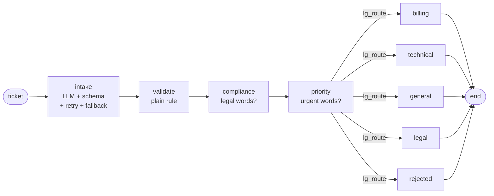

# From LLM to Agent

**DMLS Agentic AI Workshop · Session 1**
Dalhousie Machine Learning Society · Hosts: Akash Maity & Akshit Bhalla

[](https://colab.research.google.com/github/Akash324-dotcom/DMLS_Agentic_AI/blob/main/notebooks/Session1_From_LLM_to_Agent_STUDENT.ipynb)

In this session you build a **customer-support triage agent** from scratch, the way a production team would. You build it in plain Python first, so you understand every piece, and then you rebuild it in **LangGraph**.

The idea behind the whole session fits in one line:

> **The LLM makes one judgement. Plain code does everything else.**

Everything here runs in **Google Colab** on **Groq's free tier**. You don't need a credit card or a GPU, and you don't install anything on your laptop.

---

## The story

It's your first Monday as the AI engineer at **Harbourline**, a small Halifax software company. The support inbox has 4,000 unread tickets. Your manager gives you one sentence:

> *"Make the inbox sort itself. And when it gets one wrong, I want to know **why**."*

By the end of the session you will have built an agent that:

- reads each ticket and decides whether it's **billing**, **technical** or **general**
- rejects junk tickets (like `"hi"`) with a plain rule, without calling the model
- escalates anything that mentions a lawyer to **Legal**, and tags outages as **high priority**
- **survives the model API going down**, using retries and then a keyword fallback
- writes a **trace** of every decision, so you can answer "why did it do that?"
- runs as a **LangGraph** graph
- has **tests**, including tests for the parts that use the LLM

---

## The final agent



Only `intake` calls the language model. Every other box is ordinary Python. In the lab you add one more path: **urgent**.

---

## Quick start (about 5 minutes)

### 1. Get a free Groq API key
Go to **[console.groq.com/keys](https://console.groq.com/keys)**, sign in, and click **Create API Key**. Copy the key; it starts with `gsk_`.

> **Use your own account.** Free limits are per account. If a whole table shares one key, everyone hits the limit at the same time and the code starts failing halfway through the lab.

### 2. Open the notebook in Colab
Click the **Open in Colab** badge at the top of this page. Then go to **File → Save a copy in Drive**, so your work is saved to your own Drive.

### 3. Add your key to Colab Secrets
1. In the left sidebar of Colab, click the **key icon** (Secrets).
2. Click **Add new secret**.
3. Name: `GROQ_API_KEY` (all capitals, exactly like this). Value: paste your key.
4. Switch on **Notebook access**.

> **Never paste your key directly into a code cell.** If you share the notebook or push it to GitHub, your key goes with it, and bots scan GitHub for leaked keys all day. Secrets keeps the key out of the notebook.

### 4. Run Chapter 0
Run the cells in Chapter 0 from top to bottom. The last cell is a smoke test. If it prints a one-sentence answer within about 5 seconds, you're ready.

---

## How the notebook works

Every exercise has a worked example just above it that solves a *different* problem, a pizza shop, using the same technique. Study the pizza version, then copy the **pattern**, not the code.

| Label | Meaning |
|---|---|
| **GIVEN** | Run it, read it, move on. |
| **EXAMPLE** | The pizza-shop twin of the exercise below it. |
| **YOUR TURN** | Replace every `raise NotImplementedError` with your own code. |
| **CHECK** | Run it after a YOUR TURN cell. If it passes, move on. |

Run cells **top to bottom**. If something breaks, read the error and the trace before you read your code.

---

## What's inside

| Chapter | Topic | What you build |
|---|---|---|
| 0 | Setup | Your key, the model, the smoke test |
| 1 | What an LLM actually does | Watch tokens, temperature and "no memory" happen live, then hit the ceiling: *"Book me the cheapest flight under $400."* |
| 2 | What we're building | Chatbot vs pipeline vs workflow vs agent; the agent loop; why most production agents are state machines |
| 3 | Structured output | A Pydantic schema (`TicketClassification`) and a classifier that always returns a valid object |
| 4 | The state machine | `TicketState` and the intake → validate → route nodes, plus the controller that runs them |
| 5 | Error handling | Retry with exponential backoff (1s, 2s, 4s), then a keyword fallback. You break the API on purpose. |
| 6 | Branching and the reducer | Compliance and priority checks writing into one shared state |
| 7 | Observability | A `traced_node` decorator that logs every node as one JSON line |
| 8 | The LangGraph rebuild | The same agent as nodes, edges and a router |
| 9 | Testing | Shape tests for LLM output, exact tests for plain code, run with pytest |
| 10 | **Lab: add the urgent path** | Schema, node, routing, retry-safe fallback, trace and a test |
| 11 | The sentence | How to describe what you built, in one line |

### The test tickets

| ID | Ticket | Where it should end up |
|---|---|---|
| T-001 | My invoice #4521 charged me twice. | Billing |
| T-002 | My server keeps crashing after the last update. | Technical |
| T-003 | What are your office hours over the holidays? | General |
| T-004 | hi | Rejected (too short) |
| T-005 | My server keeps crashing, this is urgent | Technical, **high priority** |
| T-006 | I was billed twice and my lawyer says this is grounds for legal action. | **Legal** |
| T-007 | Our production server is down, this is urgent | Your job in the lab |

---

## The lab (Chapter 10)

Ops wants a fourth path, **urgent**, because outages shouldn't wait behind billing questions. Your checklist:

- [ ] **Schema:** `"urgent"` is a valid category
- [ ] **Node:** `lg_handle_urgent` pages the on-call engineer
- [ ] **Route:** the urgent node is actually reachable in the graph
- [ ] **Retry-safe:** urgent tickets go through retry and fallback. Does your *fallback* know what urgent means?
- [ ] **Trace:** it logs like every other node
- [ ] **Test:** at least one test, and you can say why you chose that kind

**Success looks like this:** T-007 gets an urgent response, its trace shows how it got there, and Check 10 still passes **during a simulated outage**.

**Stuck?** Read the trace before you read your code. Which node ran last?

<details>
<summary>Hints (open only if you're stuck)</summary>

1. An outage is *also* a technical problem. How does the model know which one you mean? Look up `Field(description=...)`; Instructor sends that description to the model.
2. If you get an error mentioning `'urgent'` right after the priority node runs: `lg_route` returned `"urgent"`, but LangGraph doesn't know where that leads. Check the mapping you pass to `add_conditional_edges`.
3. If it works normally but Check 10 warns you about the outage: during an outage the model can't be reached, so your keyword fallback decides. Does it check for urgent words, and does it check them *before* technical words?

</details>

The full lab solution is in the **student guide (Appendix F)**. Try the lab yourself first.

---

## Troubleshooting

| What you see | What it means | Fix |
|---|---|---|
| A password box appears, or a "secret not found" error | Colab can't find your key | Check the name is exactly `GROQ_API_KEY` and that **Notebook access** is switched on |
| `401` / authentication error | The key is wrong or incomplete | Create a new key and paste it again |
| `429` / "rate limit" / "Request too large" | You hit the free limit | Wait a minute. If you share a key with someone, get your own. |
| Lots of `fallback` in your traces, with confidence 0.5 | Your retries are failing, usually because of the rate limit | Same as above. This is your fallback working as designed. |
| `NameError: ... is not defined` | A cell above wasn't run | Re-run the chapter from its first cell |
| `NotImplementedError` | You haven't finished a YOUR TURN cell | Fill it in, or check the twin example above it |
| Nothing works and you're out of time | | Set `MODEL = "mock"` in Chapter 0 and re-run it. You get a fake offline model that answers with keyword rules. It's not a real LLM, but every exercise runs. |

**Backup provider:** if Groq is having a bad day, get a free key from Mistral, add it to Secrets as `MISTRAL_API_KEY`, and change the `MODEL` line in Chapter 0 to `"mistral/mistral-small-latest"`. Nothing else in the notebook changes.

> Free tiers may use your prompts for training. The notebook only uses made-up tickets, so that's fine. Never paste real customer or personal data into a free tier.

---

## What's in this repo

<!-- Edit this list to match your actual folders, then delete this comment. -->

```
.
├── notebooks/
│   └── Session1_From_LLM_to_Agent_STUDENT.ipynb   ← start here
├── guide/
│   └── DMLS_Session1_Student_Guide.pdf            ← every concept explained, expected outputs, lab solution
├── slides/
│   └── Session1_From_LLM_to_Agent.pdf
└── README.md
```

**New to Python?** Start with **Chapter P** in the student guide. It covers only the Python this session uses, from zero, in five pages.

---

## Tools used

| Tool | What it does here |
|---|---|
| [Groq](https://console.groq.com) | Runs the language model (Qwen) fast, on a free tier |
| [Pydantic](https://docs.pydantic.dev) | Describes the exact shape the model's answer must have |
| [Instructor](https://python.useinstructor.com) | Sends that shape to the model, validates the reply and re-asks if it doesn't fit |
| [LangGraph](https://langchain-ai.github.io/langgraph/) | Runs the agent as a graph of nodes and edges |
| [pytest](https://docs.pytest.org) + ipytest | Runs real tests inside the notebook |

---

## After the session: make it a portfolio piece

You built something real. Don't leave it sitting in a notebook nobody sees.

- [ ] **Repo:** push your finished notebook to a public GitHub repo. First, clear all outputs (Edit → Clear all outputs) and make sure no cell contains your key.
- [ ] **README:** describe the problem, add the graph (paste the Mermaid output from Chapter 8; GitHub draws it for you), and say how to run it
- [ ] **Decisions:** write two short paragraphs. Why a state machine? Why only one LLM call?
- [ ] **Trace:** paste one ticket's trace
- [ ] **Tests:** they pass, and you can say what each kind tests
- [ ] **Yours:** add one extension that nobody else built

**Extension ideas:**
- Validate *before* intake, so `"hi"` never costs a model call
- Fix the keyword bug: `"I can't download my invoice"` gets flagged as urgent, because "download" contains "down" (hint: regular expressions with `\b`)
- Send tickets with low confidence to a human review queue
- Label 20 tickets yourself and report the classifier's accuracy (your first golden dataset)
- Fall back to a second provider before falling back to keywords
- Wrap *every* node with `traced_node`, not just intake and validate
- Run compliance and priority truly in parallel in LangGraph

**Résumé line you can adapt:**
> Built a support-ticket triage agent in Python (Pydantic, Instructor, LangGraph) with schema-validated LLM output, retries with a keyword fallback, per-node JSON tracing and pytest coverage. Extended it with ____.

Please credit the workshop in your README, for example: *"Built at the DMLS Agentic AI Workshop, extended with ..."*. It's honest, and it's more impressive than pretending you started from nothing. Your extension is the part you'll defend in interviews.

---

## Can you answer these out loud in 30 seconds each?

If you can, you can defend this project in an interview.

**Explain it**
1. When would you *not* build an agent?
2. How do you get reliable JSON from an LLM?
3. Which nodes use the LLM, and why?

**Defend it**
4. The model API goes down. Then what?
5. A ticket went to the wrong team. Show me why.
6. How do you test output that's random?

---

## The sentence

When someone asks what you built, don't say "a chatbot." Say this:

> *"I designed a stateful agent with structured output, retry and fallback logic, and full tracing, then reimplemented it in LangGraph and tested the parts that needed testing."*

---

## About DMLS

The **Dalhousie Machine Learning Society** runs hands-on ML workshops, projects and events for students at Dalhousie University.

- Email: **dmls@dal.ca**
- Socials: **@dalmlsociety**

Questions about this session? Open an issue in this repo or email us.
